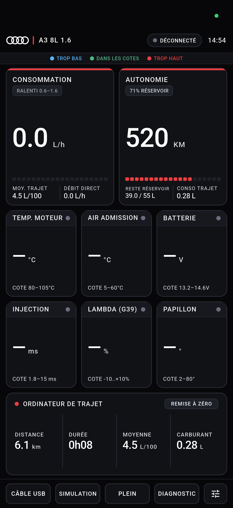
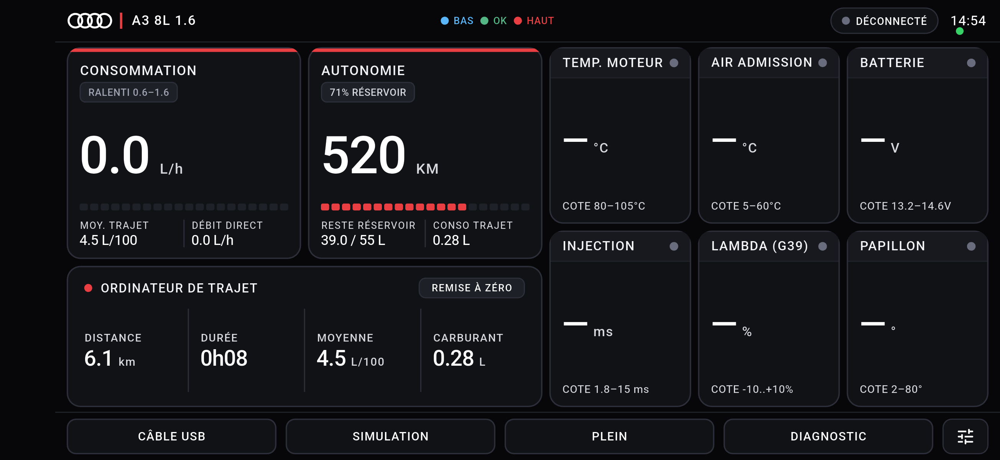

<div align="center">

# OldBoard

**Ordinateur de bord & diagnostic OBD KWP1281 Open-Source pour véhicules VAG (1995–2004)**

[](https://github.com/supermedmed-hash/OldBoard/releases/latest)
[](https://github.com/supermedmed-hash/OldBoard/actions/workflows/build.yml)
[](https://flutter.dev)
[](android/app/src/main/kotlin/com/oldboard/oldboard/Kwp1281.kt)
[](LICENSE)

Transforme n'importe quel smartphone ou autoradio Android en véritable **afficheur OEM haute lisibilité** pour **Audi, Volkswagen, SEAT et Škoda (1995–2004)** sur ligne **K-Line / KWP1281** — idéal pour les compteurs sans FIS/MFA d'origine.

</div>

---

## 📸 Aperçu (captures réelles sur Android)

<table>
  <tr>
    <td align="center" width="32%">
      
      <br />
      <sub><b>Mode Portrait</b> — Audi A3 8L 1.6 AKL</sub>
    </td>
    <td align="center" width="68%">
      
      <br />
      <sub><b>Mode Paysage</b> — Support téléphone / Autoradio Android</sub>
    </td>
  </tr>
</table>

> Conçu et calibré sur route à partir d'une **Audi A3 8L 1.6 AKL (1999, Siemens Simos 2.1 `06A906019AM`)**, avec compatibilité universelle testée automatiquement du `320×568` aux autoradios `1280×480` et tablettes.

---

## 📥 Téléchargement rapide (Android)

1. Téléchargez **`OldBoard-release.apk`** depuis la [**dernière Release GitHub**](https://github.com/supermedmed-hash/OldBoard/releases/latest).
2. Installez l'APK sur votre téléphone Android *(autorisez l'installation depuis cette source si demandé)*.
3. **Mises à jour automatiques intégrées** : l'application vérifie silencieusement GitHub Releases dès qu'une connexion Internet est disponible et propose le téléchargement + installation en 1 clic depuis l'app *(désactivable dans Réglages)*.

---

## ✨ Fonctionnalités

* **Connexion directe USB-OTG (zéro Bluetooth instable, zéro GPS)** : pilote natif Android Kotlin ([`Kwp1281.kt`](android/app/src/main/kotlin/com/oldboard/oldboard/Kwp1281.kt)) avec initialisation 5 bauds, blocs `0xE7` (triplets) et `0x02`/`0xF4` (4 octets bruts Simos 2.1), reconnexion FTDI propre et faible consommation batterie.
* **Détection automatique du véhicule & Thèmes OEM** : identifie le combiné (`0x17`) et le calculateur moteur (`0x01`) pour appliquer automatiquement le thème de la marque (**Audi Rouge**, **VW Bleu Indiglo**, **SEAT Sport**, **Škoda Vert OEM**), les groupes de mesures et les formules.
* **Télémétrie temps réel absente du compteur d'origine** :
  * **Consommation directe** (`L/100 km` en roulant, `L/h` au ralenti) via débitmètre **MAF G70** (essence) ou débit direct `L/h` / `mg/coup` (TDI), avec détection de la **coupure d'injection en frein moteur (`0.0 L/100`)**.
  * **Autonomie & Réservoir** : lecture de la jauge carburant en litres au combiné (`0x17`) au démarrage, suivi du reste réservoir et calibration automatique à chaque plein complet.
  * **Températures & Électricité** : température culasse réelle (`G62`) au degré près *(non lissée à 90 °C)*, air d'admission (`G42`), tension batterie/alternateur (`V`).
  * **Santé moteur** : temps d'injection (`ms` ou `mg/c`), régulation **Lambda (`G39`)**, pression **Turbo (`bar`)** sur `1.8T ME7.5` (`Grp 115`) & `1.9 TDI EDC15` (`Grp 11`), ou débit d'air (`g/s`) / papillon (`°`).
  * **Code couleur instantané** : 🔵 **Bleu** trop bas · ⚪/🟢 **Blanc/Vert** dans les cotes · 🔴 **Rouge** trop haut.
* **Bilan mécanique du trajet (Min / Max)** : enregistre `MAF max`, `Papillon min/max`, `Régime max`, `Eau max`, `Batterie min` et `Lambda min/max`.
* **Diagnostic & Atelier Moteur (avec confirmation)** :
  * Lecture (`0x07`) et effacement (`0x05`) des codes défauts en français.
  * Calibrage du boîtier papillon (`0x28` — **Groupe `098`** à câble, **Groupe `060`** électronique DBW).
  * Remise à zéro des auto-adaptations (**Canal `00`**, `0x2A`).
  * Explorateur de blocs bruts (`0xE7` & `F4 raw`) et export du rapport diagnostic complet en 1 clic.
* **Tableau de bord 100 % personnalisable** : appui long sur n'importe quelle carte ou case (ou via *Réglages → Personnaliser le tableau de bord*) pour choisir parmi **4 grandes cartes** (`Consommation`, `Autonomie`, `Vitesse OBD`, `Régime moteur RPM`) et **15 capteurs** (`Vitesse`, `RPM`, `Temp. eau G62`, `Air G42`, `Huile`, `Batterie`, `Injection`, `Lambda G39`, `MAF G70`, `Papillon`, `Charge moteur %`, `Turbo / Collecteur`, `Débit L/h`, `Vitesse moyenne`…), avec **3 préréglages en 1 clic** *(OEM Conso, Sport Vitesse & RPM, Mixte)*.
* **Mode Simulation & Mises à jour auto** : test complet sans câble + notifications de mise à jour directement via GitHub Releases.

---

## 🚗 Calculateurs & Profils calibrés

| Famille ECU | Moteurs / Modèles | Protocole | Groupes lus | Papillon | Statut |
| :--- | :--- | :--- | :--- | :--- | :--- |
| **Siemens Simos 2.1 / 2.4** | `1.6 8V AKL / AEH` (A3 8L, Golf 4, Bora, Leon 1M, Octavia 1U) | `0x02` / `0xF4` | `1, 2, 3, 4, 5, 7` | `098` | ✅ Testé & calibré sur route (`06A906019AM`) |
| **Siemens Simos 3.3 / 3.4** | `1.6 8V APF / AVU / BFQ` (A3 8L Ph2, Golf 4, Leon, Octavia) | `0xE7` | `1, 2, 3, 4, 5` | `060` | 🔧 Calibré Ross-Tech (retours bienvenus) |
| **Bosch Motronic M3.8.3** | `1.8T AGU`, `1.8 20V AGN` (A3 8L, A4 B5, Golf 4) | `0xE7` | `1, 2, 3, 4, 5` | `098` | 🔧 Calibré Ross-Tech (retours bienvenus) |
| **Bosch Motronic ME7.5** | `1.8T AUM / AUQ / ARZ / BAM` (A3, S3, TT, Golf 4 GTI, Leon) | `0xE7` | `1, 2, 3, 4, 5, 115` | `060` | 🔧 Calibré Ross-Tech + Turbo `Grp 115` |
| **Magneti Marelli 4LV/4MV** | `1.4 16V` & `1.6 16V` (Golf 4, Polo, Ibiza, Fabia) | `0xE7` | `1, 2, 3, 4, 5` | `060` | 🔧 Calibré Ross-Tech (retours bienvenus) |
| **Bosch EDC15VM+ / EDC15P** | `1.9 TDI 90 / 110 / 130` (A3, Golf 4, Bora, Leon, Octavia) | `0xE7` | `1, 3, 6, 7, 11, 15` | N/A | 🔧 Calibré Ross-Tech (Turbo `11` + Conso `15`) |
| **Combiné VDO `0x17`** | A3 8L (`8L0919860E`), Golf 4 (`1J0`), Leon (`1M0`), Octavia (`1U0`) | `0xE7` | `2` (Jauge `L`) | N/A | ✅ Testé sur route (`VDO D10`) |

---

## 🔌 Matériel requis (~15 €)

1. Un smartphone ou autoradio **Android** supportant l'USB-OTG.
2. Un **câble OBD-II USB KKL VAG-COM 409.1 équipé d'une puce FTDI (`FT232RL`)** *(boîtier bleu translucide)*.
3. Un adaptateur **USB-A (femelle) vers USB-C (mâle) OTG**.

> ⚠️ Les boîtiers **ELM327 Bluetooth** standards ne sont **pas** compatibles avec les calculateurs KWP1281 purs (comme le Simos 2.1 de 1999).

---

## 🏗️ Architecture du projet

```text
android/app/src/main/kotlin/com/oldboard/oldboard/
├── Kwp1281.kt          # Implémentation bas niveau KWP1281 (init 5 bauds, 0xE7 / 0x02 / 0xF4, DTC, 0x28, 0x2A)
├── KLineManager.kt     # Thread unique de session, reconnexion matérielle FTDI & resynchronisation
└── MainActivity.kt     # Pont Flutter (USB K-Line + téléchargement / installation APK auto-update)

lib/
├── models/
│   ├── engine_data.dart          # Rôles de télémétrie moteur & valeurs horodatées
│   └── vehicle_profile.dart      # 9 profils VAG, 6 familles ECU calibrées & auto-détection OBD
├── services/
│   ├── kline_service.dart        # Interface Dart vers le pilote natif Android
│   ├── vag_decoder.dart          # Décodeur universel 0xE7 + décodeur ROM Simos 2.1 0xF4
│   ├── dashboard_controller.dart # Ordinateur de bord (conso MAF/inj/TDI, autonomie, coupure 0x08, Min/Max)
│   ├── update_service.dart       # Vérification GitHub Releases & téléchargement/installation APK
│   ├── settings.dart             # Persistance locale & journaux sauvegardés
│   └── simulator.dart            # Simulateur de conduite intégré
└── ui/
    ├── theme.dart                 # Design OEM mat haute lisibilité (sans glow)
    ├── profile_picker_screen.dart # Sélection de véhicule & emblèmes de marque
    ├── dashboard_screen.dart      # Tableau de bord adaptatif portrait/paysage (CustomPaint + zéro overflow)
    ├── diag_screen.dart           # Codes défaut, atelier moteur, blocs bruts & export rapport
    ├── settings_screen.dart       # Paramètres véhicule, injection, options OBD & mises à jour auto
    └── update_dialog.dart         # Fenêtre de mise à jour avec patch notes & barre de progression

test/
└── layout_overflow_test.dart      # Matrice de tests UI sur 9 tailles Android + tests semver
```

---

## 🛠️ Compiler depuis les sources

Prérequis : **Flutter 3.x**, **JDK 17+**, **Android SDK**.

```bash
git clone https://github.com/supermedmed-hash/OldBoard.git
cd OldBoard
flutter pub get
flutter analyze
flutter test
flutter build apk --release
```

L'APK optimisé est généré dans `build/app/outputs/flutter-apk/app-release.apk`.

---

## 🤝 Contribuer & Ajouter un calculateur

Les **forks** et **Pull Requests** sont les bienvenus ! Consultez [`CONTRIBUTING.md`](CONTRIBUTING.md) pour savoir comment :
* Capturer le rapport diagnostic complet de votre véhicule depuis l'écran `DIAGNOSTIC`
* Ajouter un nouveau profil véhicule ou un nouveau décodeur `0xF4` / `0xE7`

---

## ⚠️ Avertissement

OldBoard est un **projet open-source indépendant**, non affilié à **Audi AG**, **Volkswagen AG**, **SEAT S.A.** ou **Škoda Auto a.s.** Les noms de modèles et marques sont mentionnés uniquement à titre de compatibilité technique.
Ne manipulez pas l'application en conduisant. Utilisez les fonctions d'atelier (`Effacer codes`, `Calibrage papillon`, `RAZ Canal 00`) à l'arrêt et sous votre propre responsabilité.
